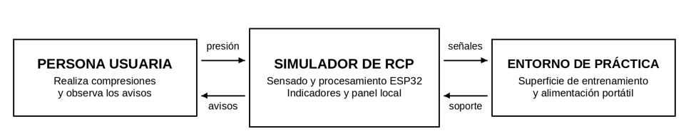
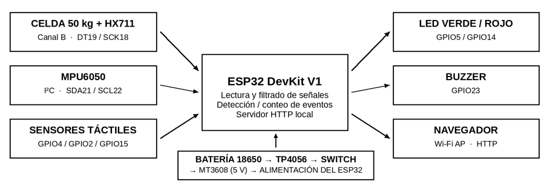
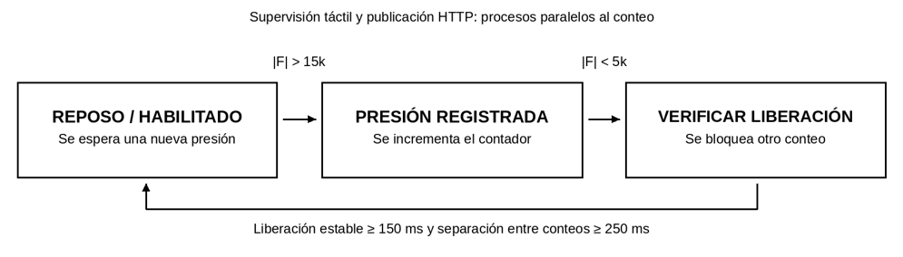
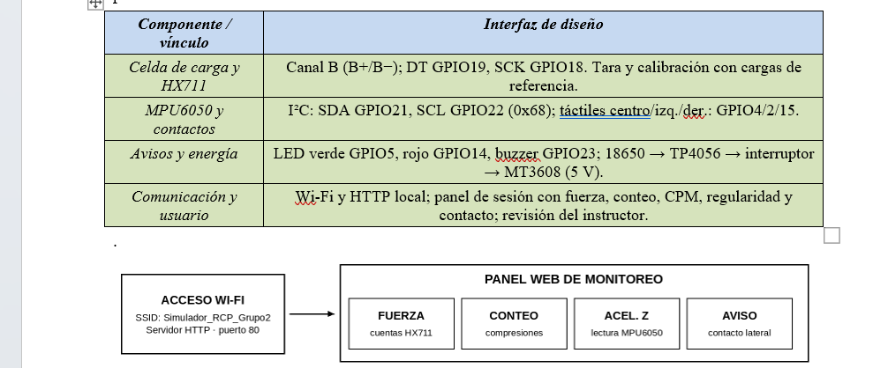
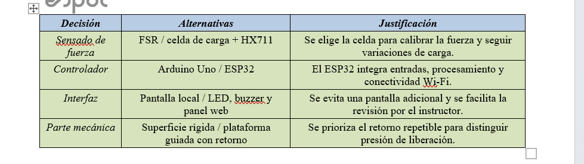
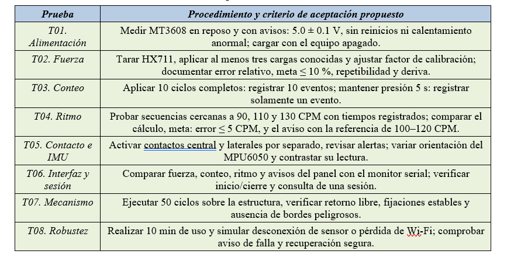

# Documento de Diseño: Smart First Aid Trainer (Simulador de RCP)

## 1. Introducción
El proyecto plantea desarrollar un simulador didáctico y portátil de reanimación cardiopulmonar para practicar compresiones sobre una superficie mecánica y recibir retroalimentación inmediata. El ESP32 procesará la celda de carga de 50 kg con HX711, el MPU6050 y tres contactos táctiles; a partir de estas señales se evaluarán el conteo, el ritmo, la regularidad y la ubicación de las manos. Los indicadores luminosos, el buzzer y un panel web permitirán consultar los resultados de cada sesión. La finalidad es apoyar la formación práctica a bajo costo, sin sustituir equipos médicos certificados.

## 2. Alcance y Limitaciones
* **¿Qué vamos a crear?:** Para la entrega final se diseñará e integrará una estación de práctica con plataforma o torso de compresión y retorno mecánico, electrónica portátil alimentado por batería 18650, TP4056 y MT3608, sensores, avisos visuales/sonoros y una interfaz web para participante e instructor. Se prevé calibrar la fuerza con cargas conocidas, calcular compresiones por minuto, analizar su regularidad, registrar sesiones de forma no identificable y validar el sistema ensamblado.
* **¿Qué NO vamos a resolver?:** El simulador evaluará la eficacia clínica de una reanimación, pero no medirá directamente profundidad ni retroceso torácico sin añadir un sensor de desplazamiento y no certificará la técnica completa de RCP. 

## 3. Diagrama de Contexto
La persona realizará compresiones sobre la estructura de práctica; el simulador procesará las señales y comunicará los avisos. El instructor podrá revisar la actividad desde un navegador conectado a la interfaz del sistema.

## 4. Diagrama de bloques del Diseño
El ESP32 coordina las entradas y decide la retroalimentación. El diseño final incorporará los indicadores por sesión, un panel web para participante e instructor y un historial consultable; la estructura mecánica permitirá repetir ciclos de presión y liberación.

## 5. Máquina de Estados (Software)
El conteo sigue tres estados: reposo, compresión detectada y espera de liberación. Una presión sostenida no debe aumentar el contador. En paralelo se revisarán los contactos táctiles, el MPU6050 y los tiempos de cada ciclo para calcular el ritmo y la regularidad, que se mostrarán al finalizar o durante la sesión.

## 6. Diseño de Interfaces
Se mantendrán las conexiones verificadas de los sensores y actuadores. La interfaz final añadirá indicadores de desempeño y una vista de resultados sin confundir las mediciones del prototipo con parámetros clínicos certificados.

## 7. Alternativas de Diseño

## 8. Plan de Test y Validación
Las siguientes pruebas corresponden a la validación de la solución completa. En cada ensayo se registrarán fecha, condiciones, resultados, evidencia (medición, foto o registro serial) y correcciones. Los criterios son metas de aceptación, no resultados obtenidos.
Instrumentación: Multímetro, pesas o cargas patrón, cronómetro, monitor serial, navegador y registro de evidencias. Las tolerancias de fuerza se definirán tras caracterizar el mecanismo.

## 9. Consideraciones Éticas
El proyecto busca ampliar el acceso a prácticas de RCP mediante un equipo de menor costo y reutilizable. Sin embargo, un conteo o una señal verde no prueban que una maniobra sea clínicamente correcta. Como medida preventiva, el equipo se identificará como simulador académico, mostrará el alcance real de sus mediciones y se utilizará con orientación de una persona capacitada.
Para reducir riesgos de seguridad y privacidad se aislarán los conductores, se fijará la batería, se verificará la protección de carga y se evitará usar el simulador mientras se recarga. El panel empleará acceso protegido y, si registra sesiones, utilizará identificadores anónimos y datos mínimos. Los avisos visuales se complementarán con sonido e instrucciones claras para facilitar su interpretación.
En el aspecto ambiental, se priorizará una batería recargable frente a pilas desechables, una estructura desmontable con piezas reemplazables y componentes reutilizables para reducir residuos por mantenimiento. Se limitará el consumo cuando el equipo esté inactivo y se separarán batería, circuitos y materiales del mecanismo al terminar su vida útil, para llevarlos a gestores autorizados de residuos electrónicos. Estas medidas pretenden extender la duración del prototipo y evitar la disposición inadecuada de materiales.
